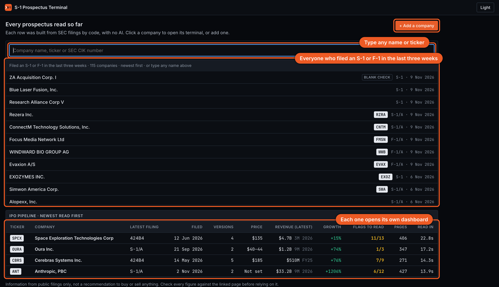
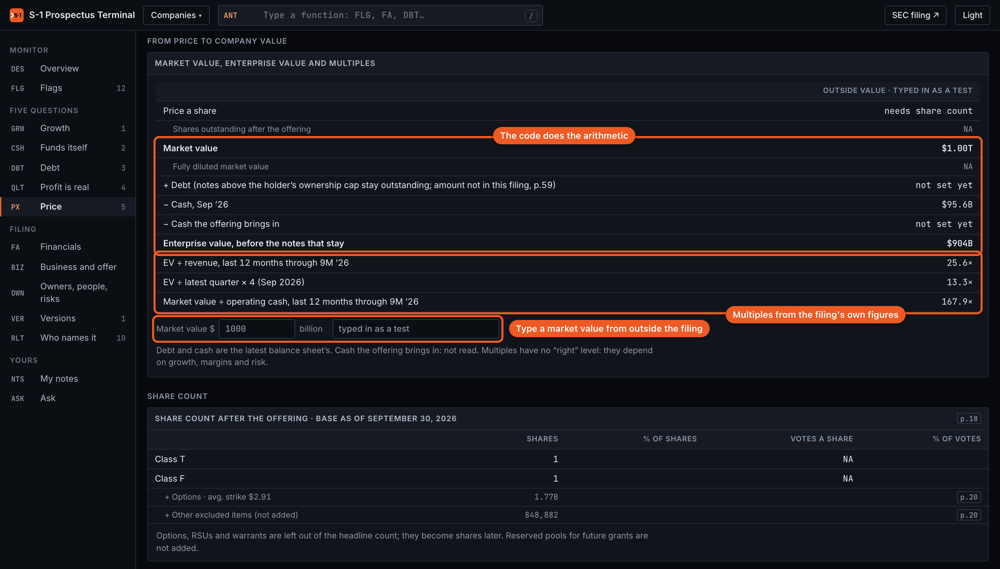
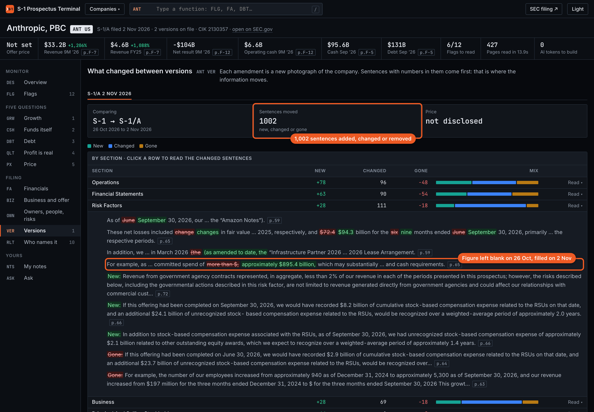
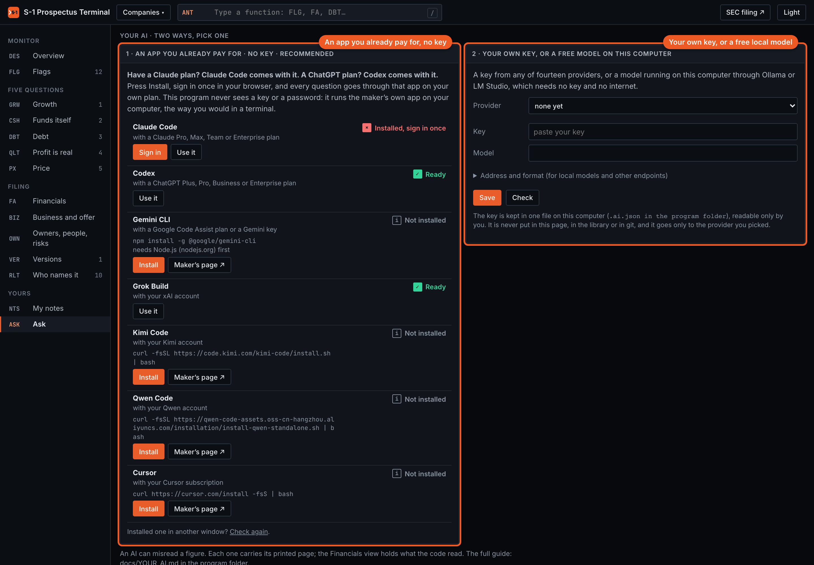

<p align="center">
  <a href="https://greeksoup.ai">
    <picture>
      <source media="(prefers-color-scheme: dark)" srcset="assets/banner-dark.svg">
      
    </picture>
  </a>
</p>

<p align="center">
  <a href="https://github.com/greeksoup/s1-prospectus-terminal/actions/workflows/check.yml"></a>
  <a href="#how-do-i-install-it"></a>
  <a href="START_HERE.md"></a>
  <a href="https://www.sec.gov/edgar/search/"></a>
  <a href="docs/YOUR_AI.md"></a>
  <a href="LICENSE"></a>
  <a href="https://ai.shikshannivesh.com"></a>
</p>

# S-1 Prospectus Terminal

A free program that reads a company's US IPO prospectus (its S-1 or F-1 filing at the SEC) and
turns it into one dashboard in your browser. Every figure carries the printed page it came from.
Code reads the filing, with no AI, so it costs nothing to run again and gives the same answer
every time. Made by the team at [greeksoup.ai](https://greeksoup.ai), a web-based stock research
platform.

How we built it, step by step: [the Alpha with AI edition](https://ai.shikshannivesh.com/p/how-we-built-an-ipo-dashboard-program).

<p align="center"></p>

**Install with one line** (details [below](#how-do-i-install-it)):

Mac or Linux, in Terminal:

```bash
curl -fsSL https://raw.githubusercontent.com/greeksoup/s1-prospectus-terminal/main/install.sh | bash
```

Windows, in PowerShell:

```powershell
irm https://raw.githubusercontent.com/greeksoup/s1-prospectus-terminal/main/install.ps1 | iex
```

[Start here, in plain words](START_HERE.md) · [Install](#how-do-i-install-it) · [Add a company](#how-do-i-read-a-company-that-is-not-on-the-list) · [Your AI](docs/YOUR_AI.md) · [Alpha with AI, the newsletter](https://ai.shikshannivesh.com) · [greeksoup.ai](https://greeksoup.ai)

## What does it do?

You pick a company that has filed for a US IPO. The program finds its prospectus on SEC EDGAR,
reads every printed page, and lays out:

- **Five questions, in a fixed order, price always last.** Is revenue really growing? Does it fund
  its own growth? Is the debt sane? Does the profit show up as cash? Only then: is the price sane?
- **Flags**: things a careful reader would stop on, such as a profit that never turns into cash,
  a customer named in the body of the prospectus but missing from the audited statements, a
  founder holding most of the votes with few of the shares, or a senior executive who left just
  before the filing.
- **The financial statements as printed**, every line in the filing's own order and labels, with
  the change from the year before under each line. Each table downloads as a spreadsheet.
- **Owners and votes**: who holds the shares against who holds the votes after the offering.
- **What changed between versions** of the filing, sentence by sentence, the ones with numbers
  first.
- **Who else names it**: other companies' SEC filings that mention this one, ranked by whether a
  dollar amount sits near words like agreement or contract.
- **The price box**, explained [below](#what-is-the-price-box).

When the filing is silent the dashboard says "not disclosed". When the code could not read a table
it says "not read". It never shows a zero it did not see.

## Who does what: code, AI and you?

- **Code does everything that repeats**: finding the filing, reading the tables, raising the
  flags, comparing one version with the next and drawing the dashboard. It costs nothing to run
  again.
- **Code also does all the arithmetic.** AI is bad at arithmetic and can hand you a number that
  looks right and is not. While we tested this program, one AI answer turned $130,502 million into
  "$130.5 million", a thousand times too small. Code reads the printed figure the same way every
  time.
- **AI only answers your own questions**, on the AI you already pay for (ChatGPT, Claude or
  another), and the code sends it just the three or four pages that match your question.
- **The judgment stays with you**: explaining the business in five lines of your own, checking
  what has changed since the filing date, and deciding what the price is worth to you.

## How do I install it?

It takes a few minutes the first time. You paste one line, press Enter, and the dashboard opens in
your browser.

**On a Mac:** press `Command` + `Space`, type **Terminal**, press Enter. Paste this line and press
Enter:

```bash
curl -fsSL https://raw.githubusercontent.com/greeksoup/s1-prospectus-terminal/main/install.sh | bash
```

**On Windows:** press the Start button, type **PowerShell**, press Enter. Paste this line and press
Enter:

```powershell
irm https://raw.githubusercontent.com/greeksoup/s1-prospectus-terminal/main/install.ps1 | iex
```

**On Linux:** open a terminal and paste the Mac line.

What the line does, in order:

1. Checks for Python 3.10 or newer, the free engine the program runs on. If it is missing:
   on a Mac it downloads Python from python.org, checks the file is python.org's own and signed
   by the Python Software Foundation, and installs it (your Mac asks for your password once). On
   Windows it installs Python with winget, Windows' own app installer. On Linux it tells you the
   one line that installs it.
2. Downloads the newest release of this program from GitHub into a folder called
   `S1-Prospectus-Terminal` in your home folder.
3. Gives the program its own private Python space inside that folder, installs its three small
   libraries there, draws the dashboards and opens them in your browser.

Nothing is installed anywhere else on your computer (apart from Python, if it was missing), and
nothing starts by itself when you switch your computer on. Keep the text window open while you use
the program; close it to stop. Both install scripts are short plain-text files you can read first:
[install.sh](install.sh) and [install.ps1](install.ps1). A GitHub check runs both on fresh Mac,
Windows and Linux machines on every change.

**Next time**, paste the same line again, or double-click the starter in the folder:
`start-mac.command` on a Mac, `start-windows.bat` on Windows, `start-linux.sh` on Linux. Each start
checks for a newer version and asks before updating. Your notes, your downloaded filings and your
AI key stay as they are.

**Prefer not to paste a line?** Download the
[latest release](https://github.com/greeksoup/s1-prospectus-terminal/releases/latest)
(**Source code (zip)**), unzip it, and double-click the starter for your computer.
[START_HERE.md](START_HERE.md) walks through it, including the warning Mac and Windows show the
first time you open a downloaded file.

**To remove it**, close the text window and delete the `S1-Prospectus-Terminal` folder.

## How do I read a company that is not on the list?

SpaceX, Anthropic, Cerebras and Oura are already read when you install. For any other company:

1. On the front page, press **+ Add a company**. A list drops down with every company that filed
   an S-1 or F-1 at the SEC in the last three weeks, newest first.
2. Click one, or type any company's name or ticker in the box.
3. The page shows how far it has got. A minute or two later the new dashboard opens by itself,
   and it stays on the front page from then on.

<p align="center"></p>

On any dashboard, the **Companies** menu at the top switches company, and its last line,
**+ Add a company**, brings you back to the list. Companies marked **blank check** are SPACs: they
raise money first and buy a business later, so their prospectus has no business numbers yet.

## Where does each number come from?

From the filing itself. Every figure sits next to a small tag with its printed page, such as
`p.F-7`, the page number printed at the bottom of that page in the prospectus. Click **SEC filing**
at the top to open the filing on SEC.gov and check it.

<p align="center"></p>

## What is the price box?

Before a company sets its price, the price screen shows "Not set". Once a filing prints a price or
a range, the screen works out the market value, the enterprise value and the multiples by itself.

Until then you can type in a market value you read somewhere else, add where you read it, and the
code works out what it means against the filing's own figures. Enterprise value is the market value
plus the company's debt and minus its cash, roughly what it would cost to buy the whole business. A
multiple divides that value by a figure such as revenue, so companies of different sizes can be
compared. The column you typed is labelled as an outside value, so it never gets mixed up with what
the filing says.

<p align="center"></p>

The debt line reads the filing's own conditions. In Anthropic's amended S-1, Amazon's convertible
notes turn into shares at the IPO only up to an ownership cap, and any part above the cap stays as
debt (page 59). The filing leaves that amount blank, so the debt line says "not set yet" with the
page beside it, and enterprise value is labelled "before the notes that stay" until a later filing
prints the amount.

## How do I know when the filing changes?

Companies file amendments, and the price usually arrives only in a later one. While a dashboard is
open it checks EDGAR, the SEC's filing system, every 12 hours and offers to update itself when a
newer filing appears. The versions screen then shows every sentence that changed, the ones with
numbers first.

<p align="center"></p>

## Can I ask my own questions about a filing?

Yes, in the **Ask** view. You type a question in plain English. The code finds the three or four
printed pages that match it best and sends them, together with everything it has already read, to
the AI you pick. Every answer lists the pages it was taken from, so checking a figure takes a few
seconds.

- **An AI you already pay for, no key.** Claude through Claude Code with a Claude plan, ChatGPT
  through Codex with a ChatGPT plan, or Gemini, Grok and a few others. Press **Install**, then
  **Sign in**, which finishes in your browser. The program never sees a password.
- **Your own key, or a free model on your own computer.** A key from any of fourteen providers, or
  Ollama or LM Studio, which need no key and send nothing off your computer.

<p align="center"></p>

The full guide, with every install line: [docs/YOUR_AI.md](docs/YOUR_AI.md). Everything else in
the dashboard works with no AI at all. An AI can still misread a figure, so check each one against
its page, or against the Financials view, which the code read.

## What filings does it read?

US registration statements: S-1, S-1/A, F-1, F-1/A and the final 424B prospectus. It handles both
page layouts SEC filing agents use, figures reported in thousands or millions, fiscal years that do
not end in December, and statements that run over several pages. US filings only for now; the code
is open, so anyone can change it to read another market's filings.

## Is it safe?

- It runs on your own computer. It talks to SEC EDGAR, to GitHub for the version check, and to the
  AI you choose only when you ask a question. Nothing else.
- It installs nothing outside its own folder (apart from Python, if it was missing) and starts
  nothing with your computer.
- Your AI key, if you use one, is kept in one file in the program folder, readable by you only,
  and never shown in the page.
- Every release is signed by the GreekSoup team. The install line and the update check that
  signature, and every file against it, before anything is written, and stop if anything does not
  match. You see nothing of this unless a check fails.
- Every script is plain text you can read before running.

## For people who use a terminal

Inside the program folder, with its environment active (`source .venv/bin/activate`, or
`.venv\Scripts\activate` on Windows):

| Command | What it does |
|---|---|
| `python3 -m prospectus "Cerebras"` | read the newest prospectus and open its dashboard |
| `python3 -m prospectus CBRS --no-open` | same, by ticker, without opening the browser |
| `python3 -m prospectus serve` | start the local server and open http://127.0.0.1:8861 |
| `python3 -m prospectus ask 2130357 "What happens to the notes at the IPO?" --app codex` | ask from the terminal (any app, `--model` optional) |
| `python3 -m prospectus apps` | every AI app the program knows, whether each is installed and signed in |
| `python3 -m prospectus refresh` | check EDGAR for a newer filing of every company and rebuild those |
| `python3 -m prospectus library list.txt` | read every company named in the file, one name or ticker a line |
| `python3 -m prospectus redraw` | redraw every dashboard from `library/` with the current design, no downloads |

By hand, without the install line:

```bash
python3 -m venv .venv
source .venv/bin/activate        # Windows: .venv\Scripts\activate
pip install -r requirements.txt
python3 -m prospectus serve
```

The three libraries are `beautifulsoup4` and `lxml` (reading the filing's HTML) and `certifi`
(the certificates that reach SEC.gov, which the Python from python.org lacks on a Mac). SEC asks
programs to identify themselves; if SEC ever refuses a request, set your own:
`export S1_PROSPECTUS_TERMINAL_UA="your-name you@example.com"`. The install line takes two optional
settings: `S1PT_HOME` (the folder) and `S1PT_VERSION` (a given release).

Dashboards are saved in `dashboards/`, one HTML file per company that opens offline, plus
`index.html`. `library/` holds the data for every company read so far, so a fresh copy shows them
all after `python3 -m prospectus redraw`.

### Moving around a dashboard

Each view has a short code, the way research terminals name their screens. Press `/`, type a code
or a word ("debt", "flags") and press Enter.

| Code | View |
|---|---|
| DES | Overview: the five questions, filing history, charts, flags, who names it |
| FLG | Flags, filtered by type; click a row for the filing's own words |
| GRW · CSH · DBT · QLT · PX | The five questions, in order |
| FA | Every line of the income statement, balance sheet and cash flow as printed, with a CSV download |
| BIZ | The business in its own words, and the offer: shares, price, exchange, underwriters, lock-up, use of proceeds |
| OWN | Share classes and votes, largest holders, executives and board, people who left, every risk heading |
| VER | What changed between versions, section by section |
| RLT | Other companies' filings that name it |
| NTS | Your five lines and what changed after the filing (saved in your browser only) |
| ASK | Questions about the filing, answered by the AI you choose |

### Tests

Over 340 checks in 15 files. Most replay real filings against figures read by hand on SEC's own pages;
the AI one runs against a stand-in model, and the update and add-a-company ones need no internet.

```bash
python3 -m tests.test_ai                 # 29: every app listed, both key formats, Ollama, the key never reaches the page
python3 -m tests.test_update             # 21: an update replaces the program, keeps your notes, filings and key, refuses an unsigned or changed release
python3 -m tests.test_signing            # the release signature, the installers' check, no file changed since signing
python3 -m tests.test_addco              # 18: + Add a company: the list, progress in plain words, a company picked twice is read once
python3 -m tests.test_spacex_tables      # 9 figures from the SpaceX S-1 (20 May 2026)
python3 -m tests.test_spacex_questions   # 15 answers
python3 -m tests.test_spacex_flags       # 7 findings
python3 -m tests.test_anthropic          # 13 figures and flags from the Anthropic S-1/A (2 Nov 2026)
python3 -m tests.test_statements         # 34 statement lines across the four filings
python3 -m tests.test_shares             # 44 share counts, lock-ups and dilution figures
python3 -m tests.test_metrics            # 20 quarterly, pay and commitment figures
python3 -m tests.test_qual               # 59 offer, owner, people and risk readings
python3 -m tests.test_pages_price_trust  # 20 page numbers and price checks
python3 -m tests.test_rezera            # 16 readings from Rezera's S-1/A, a filing that first came out mostly empty
python3 -m tests.test_filers            # 27 readings across recent S-1 and F-1 filers: banks, foreign filers, IFRS, whole dollars
```

Every file but `test_ai`, `test_update`, `test_addco` and `test_signing` needs the filings on disk first. Read the
four companies once: `python3 -m prospectus "Space Exploration Technologies"`, then `"Anthropic"`,
`"Cerebras"` and `"Oura"`. `test_rezera` and `test_filers` also need the companies they name read first.

## Something wrong, or a request?

- **A filing it misreads**: [open an issue](https://github.com/greeksoup/s1-prospectus-terminal/issues)
  with the company and the page. A misread figure with its page number is the most useful report
  there is.
- **A company you want added to `library/`**: an issue with its name is enough.
- **A contribution**: pull requests are welcome, including ones written with an AI agent. Add a
  check to `tests/` for any figure you fix.
- **How we built it**, step by step: [the Alpha with AI edition](https://ai.shikshannivesh.com/p/how-we-built-an-ipo-dashboard-program).
- **The newsletter**: [Alpha with AI](https://ai.shikshannivesh.com) carries the IPO editions this
  program grew out of.
- **The research platform**: [greeksoup.ai](https://greeksoup.ai) has a page for every US-listed
  company we cover. For the full statements of listed companies, year after year, there is
  [Shikshan Nivesh Data](https://shikshannivesh.com).

## Disclaimer

This is an investment research tool, published for educational purposes. Nothing in this
repository, and nothing the dashboard shows, is investment, legal or tax advice, or a
recommendation to buy, sell or hold any security. The author is not a registered investment
adviser or research analyst. Every figure is read by code from public SEC filings and can be
wrong, because filings get amended and code has bugs: check it against the printed page it links
to before relying on it. An answer from an AI can misread a figure too. AI coding tools,
including Claude Code, wrote this software. Investing carries risk, including the loss of
capital. Do your own research and consult a qualified professional in your jurisdiction.

## Licence

MIT, copyright Shubham Borkar. See [LICENSE](LICENSE). S-1 Prospectus Terminal is made by the
team behind [greeksoup.ai](https://greeksoup.ai) and [Shikshan Nivesh](https://shikshannivesh.com);
Alpha with AI is our newsletter.
