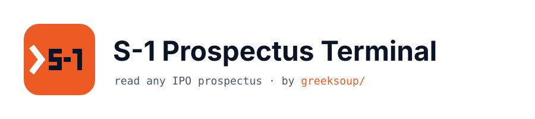
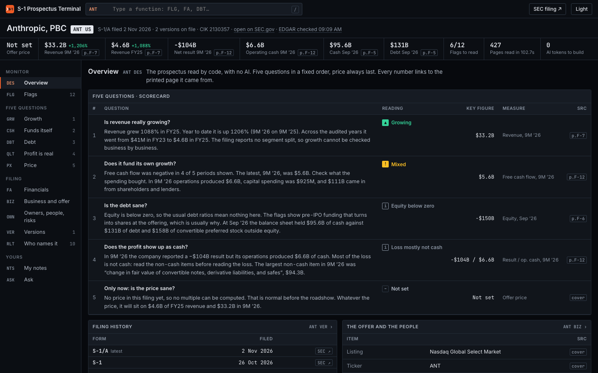
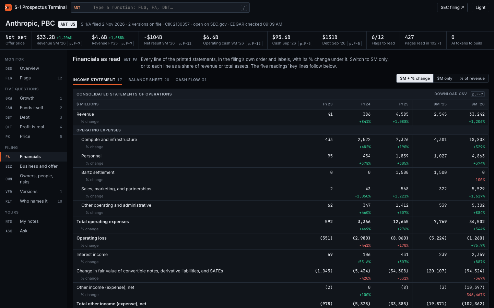
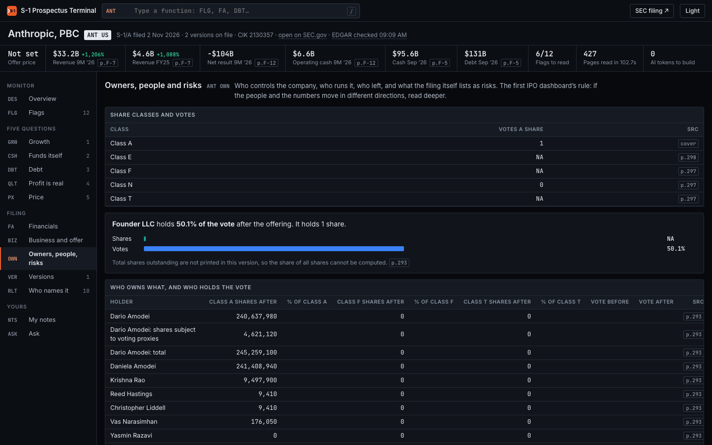
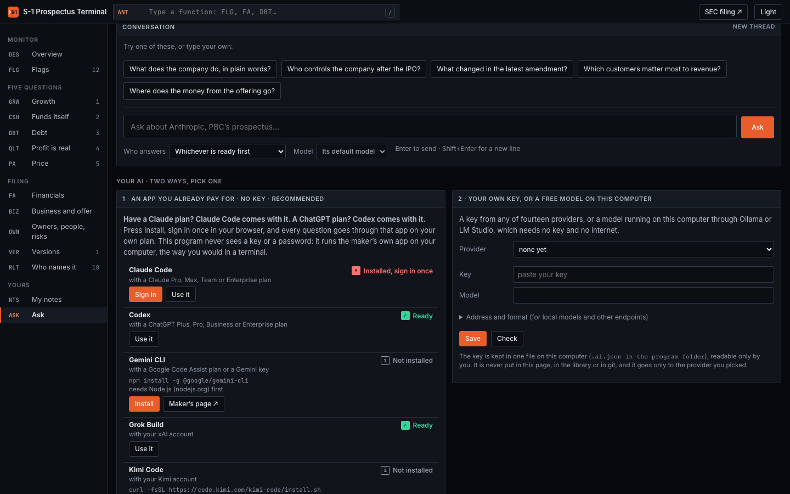

<p align="center">
  <a href="https://greeksoup.ai">
    <picture>
      <source media="(prefers-color-scheme: dark)" srcset="assets/banner-dark.svg">
      
    </picture>
  </a>
</p>

<p align="center">
  <a href="https://github.com/greeksoup/s1-prospectus-terminal/actions/workflows/check.yml"></a>
  <a href="https://www.python.org/downloads/"></a>
  <a href="START_HERE.md"></a>
  <a href="https://www.sec.gov/edgar/search/"></a>
  <a href="docs/YOUR_AI.md"></a>
  <a href="LICENSE"></a>
  <a href="https://ai.shikshannivesh.com"></a>
</p>

# S-1 Prospectus Terminal

Read any S-1 filing or IPO prospectus from SEC EDGAR as a terminal-style dashboard. Free and
open source, built by the team at [greeksoup.ai](https://greeksoup.ai), a web-based stock
research platform.

Type a company's name. The program finds its IPO prospectus on SEC EDGAR, reads every printed
page, answers five questions in a fixed order, flags what deserves a closer look, shows what
changed between versions of the filing, finds the other companies whose filings name it, and
draws all of it as one dashboard you open in your browser.

No AI reads the filing. The code does the work that repeats, for free, every time. AI is used
only when you ask a question the code did not answer, and then on the AI you choose: an app you
already pay for (no key), your own key from any of fourteen providers, or a free model on your own
computer through Ollama or LM Studio.

Press **+ Add a company** on the front page, pick from the companies that filed an S-1 or F-1 in
the last three weeks or type any name or ticker, and the dashboard opens a minute or two later.
From a terminal, the same thing is one line:

```
python3 -m prospectus "Anthropic"
```

[greeksoup.ai, our stock research platform](https://greeksoup.ai) · [Start here (plain words)](START_HERE.md) · [Install](#install) · [Your AI](docs/YOUR_AI.md) · [Alpha with AI, the newsletter](https://ai.shikshannivesh.com) · [Shikshan Nivesh Data](https://shikshannivesh.com)

<p align="center"></p>

## The five questions, in this order

1. **Is revenue really growing?** Across years, and business by business.
2. **Does it fund its own growth?** Cash from operations against what it spends.
3. **Is the debt sane?** Cash, debt, equity, and when the debt falls due.
4. **Does the profit show up as cash?** Reported profit next to operating cash flow.
5. **Only then: is the price sane?** Last on purpose.

Every number links to the printed page it came from. When the filing is silent the dashboard
says "not disclosed"; when the code could not read a table it says "not read". It never shows
a zero it did not see.

Two sections are left empty on purpose, because no code can fill them: **your five lines**
(can you explain the business to a ten-year-old?) and **what changed after the filing** (a
prospectus is a photograph frozen on its date).

## Install

**Not technical? Read [START_HERE.md](START_HERE.md).** It walks through getting Python, the
download, and the one double-click, with what to press when your computer warns you.

The short version:

1. Have Python 3.10 or newer ([python.org/downloads](https://www.python.org/downloads/); on
   Windows, tick "Add python.exe to PATH").
2. Download the [latest release](https://github.com/greeksoup/s1-prospectus-terminal/releases/latest)
   (**Source code (zip)**) and unzip it.
3. Double-click `start-mac.command`, `start-windows.bat` or `start-linux.sh`.

The starter gives the program its own Python environment inside its folder (`.venv`, nothing
installed anywhere else), installs its three libraries the first time, checks GitHub for a newer
release each time you start it and asks before updating (your notes, filings and AI key are never
touched), and opens the dashboard in your browser. There is no script to pipe into your shell and
nothing starts with your computer. Every starter is a short plain-text file you can read first; the
shared one is `scripts/start.sh`. A GitHub check runs them on fresh Windows, Mac and Linux machines
on every change.

By hand, if you prefer:

```
python3 -m venv .venv
source .venv/bin/activate        # Windows: .venv\Scripts\activate
pip install -r requirements.txt
python3 -m prospectus serve
```

The three libraries are `beautifulsoup4` and `lxml` (reading the filing's HTML) and `certifi`
(the certificates that reach SEC.gov, which the Python from python.org lacks on a Mac). The program
talks to SEC EDGAR, to GitHub for the version check, and to the AI you choose only when you ask a
question; nothing else.

## Use

| Command | What it does |
|---|---|
| **+ Add a company** on the front page | pick a recent S-1 or F-1 filer, or search any name or ticker; it reads in the background and opens the dashboard |
| `python3 -m prospectus "Cerebras"` | read the newest prospectus and open its dashboard |
| `python3 -m prospectus CBRS --no-open` | same, by ticker, without opening the browser |
| `python3 -m prospectus serve` | start the local server and open http://127.0.0.1:8861 in your browser (keep the window open) |
| `python3 -m prospectus ask 2130357 "What happens to the notes at the IPO?" --app grok` | ask from the terminal (any app, `--model` optional) |
| `python3 -m prospectus apps` | every AI app the program knows, whether each is installed and signed in, and its install line |
| `python3 -m prospectus ask 2130357 "question" --app key` | ask through your own key or local model (saved in the Ask view) |
| `python3 -m prospectus refresh` | check SEC EDGAR for a newer filing of every company and rebuild those (run it daily on GitHub's free scheduler if you like) |
| `python3 -m prospectus library list.txt` | build every company named in the file, one name or ticker a line |
| `python3 -m prospectus redraw` | rebuild the dashboards from `library/` with the current design, no downloads |

Dashboards are saved in `dashboards/`, one HTML file per company, plus `index.html` listing them.
Each file opens offline. The page design lives in `prospectus/web/`; after changing it, `python3 -m prospectus redraw`
rebuilds every dashboard from the data already saved.

## Companies already read

`library/` holds the built data for every big US IPO read so far (SpaceX, Anthropic, Cerebras, Oura
to start, more added each month). A fresh copy of this program shows them all after
`python3 -m prospectus redraw`, even years from now. An open dashboard checks EDGAR for a newer filing
(an amendment with the price range, the final prospectus with the price) once every 12 hours and
offers to update itself.

## Moving around a dashboard

Each view has a short function code, the way research terminals name their screens. Press `/`,
type a code or a word ("debt", "flags"), and press Enter.

| Code | View |
|---|---|
| DES | Overview: the five-question scorecard, filing history, charts, flags, who names it |
| FLG | Flags, filtered by type; click a row for the filing's own words |
| GRW · CSH · DBT · QLT · PX | The five questions, in order |
| FA | Every line of the income statement, balance sheet and cash flow as printed, with $M, % change and % of total, and a CSV download |
| BIZ | The business in its own words, the offer (shares, price, exchange, underwriters, lock-up, use of proceeds) |
| OWN | Share classes and votes, largest holders, executives and board, people who left, every risk heading (new or reworded ones marked) |
| VER | What changed between versions, section by section |
| RLT | Other companies' filings that name it, and what funds marked it at |
| NTS | Your five lines and what changed after the filing (saved in your browser only) |
| ASK | A conversation about the filing, with follow-ups, answered by the AI you choose: an app you pay for, your own key, or a free local model |

<p align="center"> </p>

## The question box

The code scores every printed page against your question (the same word-matching formula
search engines use), picks the three or four best pages, and hands those pages, with everything
the code already read, to the AI you choose. Two ways, side by side in the Ask view:

1. **An app you already pay for, no key.** Claude Code (with a Claude plan), Codex (with a ChatGPT
   plan), Grok Build, Kimi Code, Qwen Code, Cursor or Gemini CLI. All seven are always listed,
   installed or not: an app that is not on your computer has an **Install** button that opens a
   terminal running its maker's own install line, then a **Sign in** button whose sign-in runs in
   your browser. No key, password or sign-in token is read or copied; the program runs the app the
   way you would in a terminal.
2. **Your own key, or a free model on this computer.** Fourteen presets (Anthropic, OpenAI, Google
   Gemini, DeepSeek, Kimi, MiniMax, Z.ai, Alibaba Qwen, xAI, Mistral, OpenRouter, Ollama, LM Studio,
   any other endpoint), with a **Check** button that sends one short line. Ollama and LM Studio need
   no key and nothing leaves your computer. The key is kept in `.ai.json` in the program folder,
   readable by you only and listed in `.gitignore`; the page never sees it.

The full guide, with every install line and where it came from: [docs/YOUR_AI.md](docs/YOUR_AI.md).

<p align="center"></p>

If an app's default model is one your plan cannot use (Codex set to an API-only model on a
ChatGPT plan, say), the program retries once with a model the plan takes and says which one
answered.

An AI app can still misread a figure (one test answer turned $130,502 million into "$130.5
million"). Check each figure against its page, or against the Financials view, which the code read.

## What it reads

US registration statements: S-1, S-1/A, F-1, F-1/A and the final 424B prospectus. It handles
both page layouts SEC filing agents use (positioned pages and ordinary HTML tables), figures
reported in thousands or millions, fiscal years that do not end in December, and statements
that run over several pages.

SEC asks programs to identify themselves. If SEC ever refuses a request, set your own:
`export S1_PROSPECTUS_TERMINAL_UA="your-name you@example.com"`.

## Tests

264 checks in 11 files. Most replay real filings against figures read by hand on SEC's own
pages; the AI one runs against a stand-in model on your computer, and the update one against release zips built on the spot, with no key and no internet.

```
python3 -m tests.test_ai                 # 29: every app listed, both key formats, Ollama, the key never reaches the page
python3 -m tests.test_update             # 15: an update replaces the program and keeps your notes, filings and key
python3 -m tests.test_spacex_tables      # 9 figures from the SpaceX S-1 (20 May 2026)
python3 -m tests.test_spacex_questions   # 15 answers
python3 -m tests.test_spacex_flags       # 7 findings
python3 -m tests.test_anthropic          # 12 figures and flags from the Anthropic S-1/A (2 Nov 2026)
python3 -m tests.test_statements         # 34 statement lines across the four filings
python3 -m tests.test_shares             # 44 share counts, lock-ups and dilution figures
python3 -m tests.test_metrics            # 20 quarterly, pay and commitment figures
python3 -m tests.test_qual               # 59 offer, owner, people and risk readings
python3 -m tests.test_pages_price_trust  # 20 page numbers and price checks
```

Every file but `test_ai` and `test_update` needs the filings on disk first. Read the four companies once:
`python3 -m prospectus "Space Exploration Technologies"`, then `"Anthropic"`, `"Cerebras"` and `"Oura"`.

## Community

- **Something wrong, or a filing it misreads**: [open an issue](https://github.com/greeksoup/s1-prospectus-terminal/issues) with the company and the page. A misread figure with its page number is the most useful report there is.
- **A company you want added to `library/`**: an issue with its name is enough.
- **A contribution**: pull requests are welcome, including ones written with an AI agent. Add a check to `tests/` for any figure you fix.
- **The newsletter**: [Alpha with AI](https://ai.shikshannivesh.com) carries the IPO editions this program grew out of.
- **The research platform**: [greeksoup.ai](https://greeksoup.ai) has a page for every US-listed company we cover. For the full statements of listed companies, year after year, there is [Shikshan Nivesh Data](https://shikshannivesh.com).

## Disclaimer

This is an investment research tool, published for educational purposes. Nothing in this
repository, and nothing the dashboard shows, is investment, legal or tax advice, or a
recommendation to buy, sell or hold any security. The author is not a registered investment
adviser or research analyst. Every figure is read by code from public SEC filings and can be
wrong, because filings get amended and code has bugs: check it against the printed page it links
to before relying on it. An answer from an AI can misread a figure too. AI coding tools,
including Claude Code, wrote this software. Investing carries risk, including the loss of
capital. Do your own research and consult a qualified professional in your jurisdiction.

## Licence

MIT, copyright Shubham Borkar. See [LICENSE](LICENSE). S-1 Prospectus Terminal is made by the
team behind [greeksoup.ai](https://greeksoup.ai) and [Shikshan Nivesh](https://shikshannivesh.com);
Alpha with AI is our newsletter.
